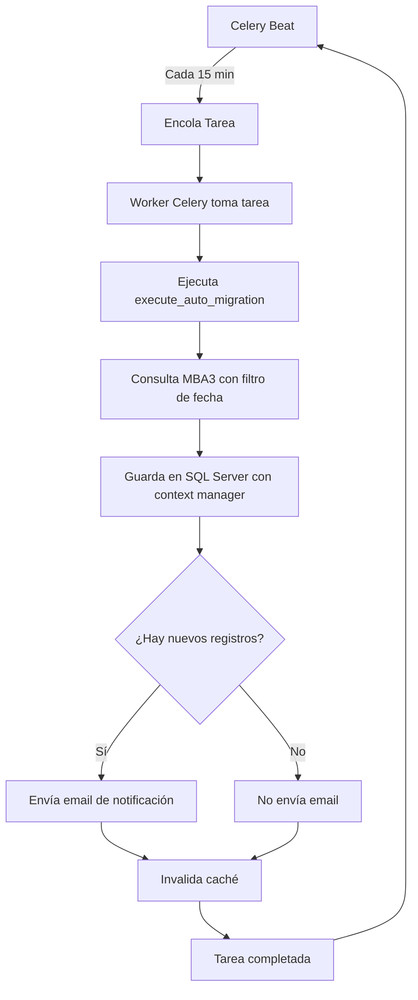

# Implementación de Celery para Migración Automática

## 📋 Descripción

Implementación de Celery para ejecutar el proceso de migración automática en un **proceso completamente aislado** de FastAPI. Esto elimina el cuello de botella entre el proceso manual y automático.

## 🎯 Problema Resuelto

### Antes (con asyncio):
```
┌─────────────────────────────────────────────────┐
│         FastAPI (UN SOLO PROCESO)               │
│                                                 │
│  ┌──────────────┐      ┌──────────────┐       │
│  │   Manual     │      │  Automático  │       │
│  │ /migrar/     │  VS  │  (asyncio    │       │
│  │  completo    │      │   cada 15min)│       │
│  └──────────────┘      └──────────────┘       │
│         │                      │               │
│         └──────────┬───────────┘               │
│                    ↓                           │
│         ⚠️ CUELLO DE BOTELLA                   │
│         - Mismo event loop                     │
│         - Mismo pool de conexiones DB          │
│         - Compiten por cliente MBA3            │
│         - Si automático está corriendo,        │
│           el manual se bloquea                 │
└─────────────────────────────────────────────────┘
```

### Después (con Celery):
```
┌──────────────────────────────────────────────────────────┐
│              PROCESO 1: FastAPI                          │
│                                                          │
│         100% dedicado a peticiones manuales              │
│                                                          │
│  Usuario → GET /migrar/completo                         │
│            ↓                                            │
│         Respuesta inmediata y rápida                    │
│         (sin competencia, sin bloqueos)                 │
└──────────────────────────────────────────────────────────┘

┌──────────────────────────────────────────────────────────┐
│         PROCESO 2: Celery Worker (AISLADO)               │
│                                                          │
│         100% dedicado a proceso automático               │
│                                                          │
│  Celery Beat → Worker → Tarea automática                │
│                          ↓                               │
│                   Corre en paralelo                      │
│                   (sin afectar FastAPI)                  │
└──────────────────────────────────────────────────────────┘
```

## ✅ Ventajas de esta implementación

1. **Aislamiento total**: El proceso automático no compite con el manual por recursos
2. **Sin cuello de botella**: FastAPI responde ágilmente incluso durante migración automática
3. **Conexiones separadas**: Cada proceso tiene su propio pool de conexiones a SQL Server
4. **Reintentos automáticos**: Celery maneja reintentos con backoff exponencial
5. **Monitoreo**: Flower proporciona un dashboard web para ver el estado de las tareas
6. **Escalabilidad**: Se pueden agregar más workers sin modificar código
7. **Context managers**: Garantiza cierre de conexiones (previene leaks)

## 🔧 Requisitos Previos

### 1. Instalar Redis

Redis se usa como broker y backend para Celery.

**Windows:**
```powershell
# Opción 1: Usando Chocolatey
choco install redis-64

# Opción 2: Descargar desde GitHub
# https://github.com/microsoftarchive/redis/releases
# Descargar Redis-x64-*.zip y extraer

# Iniciar Redis
redis-server
```

**Linux/Mac:**
```bash
# Ubuntu/Debian
sudo apt-get install redis-server
sudo systemctl start redis

# Mac con Homebrew
brew install redis
brew services start redis
```

**Verificar que Redis está corriendo:**
```bash
redis-cli ping
# Debería responder: PONG
```

### 2. Instalar dependencias de Python

```bash
# Instalar todas las dependencias
pip install -r requirements.txt

# O instalar solo Celery y Redis
pip install celery>=5.3.4 redis>=5.0.1 flower>=2.0.1
```

### 3. Configurar variables de entorno

Agregar al archivo `.env`:

```bash
# Redis para Celery
REDIS_URL=redis://localhost:6379/0

# Configuración de migración automática
ENABLE_AUTO_MIGRATE=true
AUTO_MIGRATE_INTERVAL_MINUTES=15
MIGRATE_DATE_FILTER_DAYS=365

# SQL Server (asegurar que estén configuradas)
SQL_SERVER_DRIVER={ODBC Driver 17 for SQL Server}
SQL_SERVER_SERVER=tu_servidor
SQL_SERVER_DATABASE=tu_base_datos
# ... resto de config SQL Server
```

## 🚀 Ejecución

### Opción recomendada: 3 terminales separadas

**Terminal 1: FastAPI (proceso manual)**
```bash
cd C:\Users\cortiz\PycharmProjects\mba3-consultas
python src/api_server.py
```

**Terminal 2: Celery Worker (proceso automático)**
```bash
cd C:\Users\cortiz\PycharmProjects\mba3-consultas

# Windows
celery -A src.celery_app worker --loglevel=info --pool=solo

# Linux/Mac
celery -A src.celery_app worker --loglevel=info --concurrency=2
```

**Terminal 3: Celery Beat (scheduler)**
```bash
cd C:\Users\cortiz\PycharmProjects\mba3-consultas
celery -A src.celery_app beat --loglevel=info
```

**Terminal 4 (opcional): Flower (dashboard de monitoreo)**
```bash
cd C:\Users\cortiz\PycharmProjects\mba3-consultas
celery -A src.celery_app flower

# Abrir en navegador: http://localhost:5555
```

### Verificar que todo está funcionando

1. **FastAPI**: Abrir http://localhost:8000/health - Debe responder OK
2. **Redis**: Ejecutar `redis-cli ping` - Debe responder PONG
3. **Celery Worker**: Debe mostrar `[tasks]` y estar listo para recibir tareas
4. **Celery Beat**: Debe mostrar el schedule de la tarea periódica
5. **Flower** (opcional): Abrir http://localhost:5555 - Debe mostrar el dashboard

## 📊 Monitoreo

### Ver tareas en ejecución (Flower)

Abrir http://localhost:5555 en el navegador:
- **Tasks**: Ver todas las tareas ejecutadas, en progreso y pendientes
- **Workers**: Ver el estado de los workers
- **Monitor**: Ver gráficas de rendimiento en tiempo real

### Ver logs

Los logs se muestran en las terminales correspondientes:
- **FastAPI**: Peticiones HTTP del proceso manual
- **Celery Worker**: Ejecución de tareas automáticas
- **Celery Beat**: Programación de tareas

### Verificar estado en Redis

```bash
# Conectar a Redis
redis-cli

# Ver todas las claves
KEYS *

# Ver tareas pendientes
LRANGE celery 0 -1

# Ver resultados de tareas
KEYS celery-task-meta-*
```

## 🔍 Arquitectura de Archivos

### Archivos creados/modificados:

```
src/
├── celery_app.py                    # NUEVO: Configuración de Celery
├── tasks/
│   └── celery_auto_migrate.py       # NUEVO: Tarea de migración con Celery
├── database/
│   ├── connection.py                # MODIFICADO: Agregado context manager
│   ├── __init__.py                  # MODIFICADO: Exportar context manager
│   └── services/
│       └── factura_service.py       # MODIFICADO: Usa context manager
└── api_server.py                    # MODIFICADO: Deshabilita asyncio

docs/
└── CELERY_IMPLEMENTATION.md         # NUEVO: Esta documentación

requirements.txt                     # MODIFICADO: Agregadas deps de Celery
```

## 🔄 Flujo del Proceso Automático



## ⚙️ Configuración Avanzada

### Cambiar intervalo de migración

Editar `.env`:
```bash
# Ejecutar cada 30 minutos (en lugar de 15)
AUTO_MIGRATE_INTERVAL_MINUTES=30
```

### Cambiar filtro de fecha

Editar `.env`:
```bash
# Migrar últimos 180 días (en lugar de 365)
MIGRATE_DATE_FILTER_DAYS=180
```

### Agregar más workers

```bash
# Worker 2 (en otra terminal)
celery -A src.celery_app worker --loglevel=info --pool=solo -n worker2@%h

# Worker 3 (en otra terminal)
celery -A src.celery_app worker --loglevel=info --pool=solo -n worker3@%h
```

### Ejecutar tarea manualmente (sin esperar al schedule)

```bash
# Desde Python
python -c "from src.tasks.celery_auto_migrate import execute_auto_migration; execute_auto_migration.delay()"

# O usar Flower: http://localhost:5555 > Task > execute_auto_migration > Execute
```

## 🐛 Troubleshooting

### Problema: Worker no inicia

**Error**: `No module named 'celery_app'`

**Solución**:
```bash
# Asegurar que estás en el directorio correcto
cd C:\Users\cortiz\PycharmProjects\mba3-consultas

# Verificar que src está en PYTHONPATH
echo $env:PYTHONPATH  # Windows PowerShell
export PYTHONPATH="${PYTHONPATH}:$(pwd)/src"  # Linux/Mac
```

### Problema: Redis no conecta

**Error**: `Error connecting to Redis`

**Solución**:
```bash
# Verificar que Redis está corriendo
redis-cli ping

# Si no responde, iniciar Redis
redis-server  # Windows/Linux/Mac
```

### Problema: Celery Beat no programa tareas

**Error**: Beat está corriendo pero no se ejecutan tareas

**Solución**:
```bash
# Verificar que el worker está corriendo
# En otra terminal debe estar ejecutándose:
celery -A src.celery_app worker --loglevel=info --pool=solo

# Verificar el schedule en logs de Beat
# Debe mostrar: "Scheduler: Sending due task auto-migrate-periodic"
```

### Problema: Conexiones SQL Server no se cierran

**Error**: `Connection pool exhausted`

**Solución**:
- El context manager debería cerrar las conexiones automáticamente
- Verificar logs: debe mostrar `[Context Manager] ✅ Conexión cerrada correctamente`
- Si persiste, verificar que `save_to_database` usa `get_db_connection_context()`

### Problema: Proceso manual lento

**Error**: `/migrar/completo` tarda mucho o se bloquea

**Solución**:
- Verificar que Celery Worker está corriendo (proceso separado)
- Si no está corriendo, el proceso manual NO se ve afectado
- El proceso manual **NO usa Celery**, corre directamente en FastAPI

## 📝 Notas Importantes

### ⚠️ El proceso manual NO cambió

El endpoint `/migrar/completo` funciona **exactamente igual** que antes:
- Síncrono
- Respuesta inmediata
- NO usa Celery
- NO compite con el proceso automático

### ⚠️ Context manager es crítico

El context manager en `connection.py` garantiza que:
- Las conexiones se cierren siempre
- No queden transacciones pendientes
- No se agote el pool de conexiones
- No haya deadlocks

### ⚠️ Windows requiere `--pool=solo`

En Windows, usar:
```bash
celery -A src.celery_app worker --loglevel=info --pool=solo
```

En Linux/Mac, usar:
```bash
celery -A src.celery_app worker --loglevel=info --concurrency=4
```

## 🎉 Resultado Final

Con esta implementación:

✅ **Proceso manual** (`/migrar/completo`):
- Responde inmediatamente
- No se bloquea nunca
- Pool de conexiones dedicado
- Cliente MBA3 dedicado

✅ **Proceso automático** (Celery):
- Corre en proceso separado
- No afecta a FastAPI
- Pool de conexiones propio
- Cliente MBA3 propio
- Reintentos automáticos
- Monitoreable con Flower

✅ **Base de datos**:
- Sin conexiones huérfanas
- Sin deadlocks
- Sin agotamiento del pool
- Context managers garantizan limpieza

✅ **Escalabilidad**:
- Puedes agregar más workers
- Puedes cambiar el intervalo
- Puedes monitorear con Flower
- Puedes ejecutar tareas manualmente

## 📚 Referencias

- [Documentación de Celery](https://docs.celeryq.dev/en/stable/)
- [Flower - Monitoring tool](https://flower.readthedocs.io/en/latest/)
- [Redis Documentation](https://redis.io/documentation)
- [Context Managers en Python](https://docs.python.org/3/library/contextlib.html)


